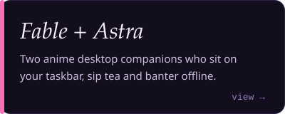
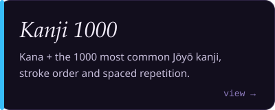
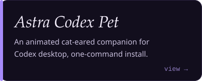

  

  
  
  
  
  
  
  
  

- 🐧 daily-driving **Gentoo** with a hand-built Hyprland + Quickshell rice
- 🎮 making games in **Unity** and **Godot**
- 🗾 learning **Japanese** so I built my own kanji app
- 🤖 tinkering with local LLMs and terminal agent tooling

  
  
  

ありがとうございます

